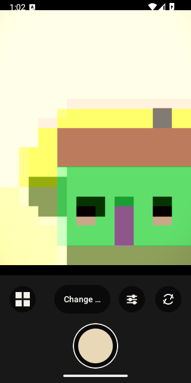
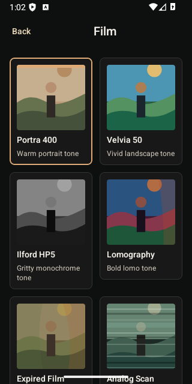
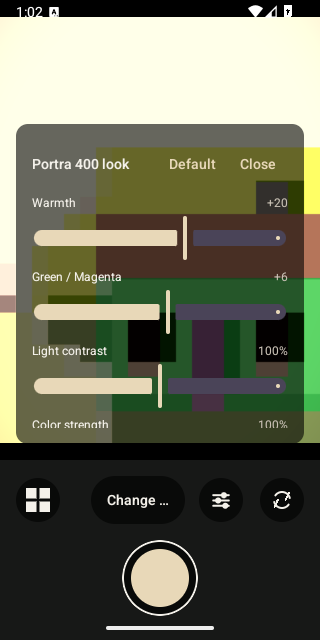

# Filmo

필름 카메라의 색감을 실시간으로 미리 보고 촬영할 수 있는 Android 앱입니다. 선택한 필름 효과가 적용된 사진을 기기에 저장하고 앱 내 갤러리에서 확인할 수 있습니다.

## 실행 화면

Android 36 에뮬레이터에서 디버그 빌드를 실행해 캡처한 화면입니다. 카메라 프리뷰의 피사체는 에뮬레이터가 제공하는 가상 장면입니다.

| 카메라 프리뷰 | 필름 선택 | 필름 설정 |
| --- | --- | --- |
|  |  |  |

## 주요 기능

- **실시간 필름 프리뷰**: CameraX 화면을 OpenGL ES와 GLSL 셰이더로 렌더링합니다.
- **7가지 필름 프리셋**: Portra 400, Velvia 50, Ilford HP5, Lomography, Expired Film, Analog Scan, Date Stamp를 선택할 수 있습니다.
- **필름 설정**: 색온도, 틴트, 대비, 채도, 그레인, 비네팅을 조절하고 기본값으로 되돌릴 수 있습니다.
- **카메라 촬영**: 전면/후면 카메라 전환과 화면 탭 포커스를 지원합니다. 프리뷰에 적용된 효과를 포함해 촬영 결과를 저장합니다.
- **사진 관리**: 기기에 저장한 사진을 갤러리에서 확인하고 삭제할 수 있습니다.

## 기술 스택

| 영역 | 기술 |
| --- | --- |
| 언어 및 UI | Kotlin, Jetpack Compose, Material 3 |
| 카메라 | CameraX |
| 이미지 처리 | OpenGL ES 2.0, GLSL |
| 구조 | Feature 기반 구조, MVI, Hilt, Navigation Compose |
| 저장 | Android MediaStore |
| 빌드 | Gradle Kotlin DSL |

## 시작하기

### 요구 사항

- Android Studio 및 Android SDK 36
- Android 7.0(API 24) 이상이며 카메라가 있는 기기 또는 에뮬레이터

### 실행

1. 저장소를 복제합니다.

   ```bash
   git clone https://github.com/polaris428/Filmo.git
   cd Filmo
   ```

2. Android Studio에서 프로젝트를 열고 Gradle 동기화를 완료합니다.
3. 카메라가 있는 기기를 연결하거나 에뮬레이터를 실행한 뒤 `app` 구성을 실행합니다.
4. 첫 실행 시 카메라 권한을 허용합니다.

명령줄에서 디버그 APK를 빌드하려면 macOS/Linux에서는 `./gradlew assembleDebug`, Windows에서는 `.\gradlew.bat assembleDebug`를 실행하세요.

## 프로젝트 구조

```text
app/src/main/
├── assets/shader/          # 필름 효과 GLSL 셰이더
├── java/com/polaris/filmo/
│   ├── core/               # 카메라, 렌더러, MediaStore, DI, 내비게이션
│   ├── data/               # 데이터 소스 및 저장소 구현
│   ├── domain/             # 모델, 저장소 인터페이스, 유스케이스
│   └── feature/            # 카메라, 필름 선택, 갤러리 화면
└── res/                    # UI 리소스 및 필름 미리보기
doc/                        # 도메인, 설계, 구현 계획 문서
```

## 문서

- [사용자 기능](doc/domain/README.md)
- [설계 및 구현 계획](doc/plan/README.md)
- [디자인 가이드](doc/design/README.md)

## 참고

촬영한 사진은 Android MediaStore의 `Pictures/Filmo`에 저장됩니다. 저장소의 계획 문서는 구현 현황보다 늦게 갱신될 수 있으므로, 현재 동작을 확인할 때는 앱 코드를 기준으로 보세요.
